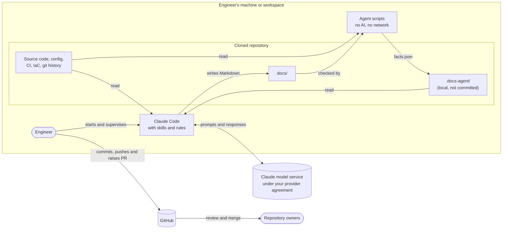
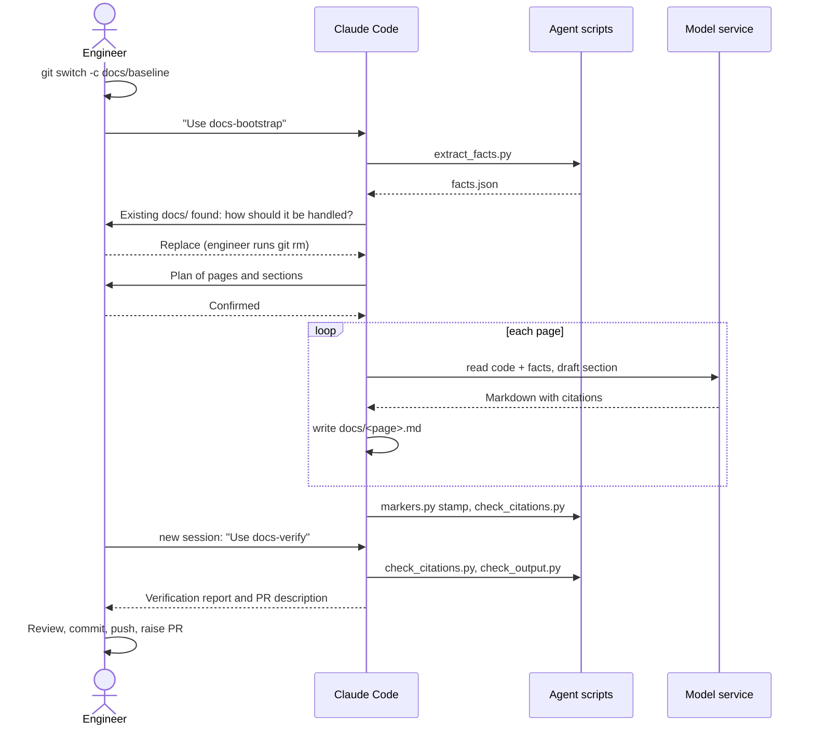

# Architecture: documentation agent (Agent 1)

This page describes the components of the documentation agent, how data moves between them, and where the trust boundaries are. For why it is designed this way, see [STRATEGY.md](STRATEGY.md). For security controls, see [SECURITY.md](SECURITY.md).

## Summary

The agent is **a set of written instructions and helper scripts** that an engineer uses with Claude Code wherever they already work on the code. There is no server, service, scheduled job, bot account or stored credential.

- The **instructions** ([RULES.md](../RULES.md) and four [skills](../skills/)) tell Claude Code how to document a repository.
- The **scripts** do everything that doesn't need AI: extracting facts, checking citations, scanning output and stamping markers. They are plain Python using only the standard library.
- **Claude Code** reads the code and writes Markdown into the repository's `docs/` folder. Its tool permissions are restricted by a settings file.
- **The engineer** starts and watches every run, approves anything outside the allowed tools, and raises the PR. The repository's owners review and merge it.

## Components

| Component | What it is | Uses AI? | Reads | Writes |
|---|---|---|---|---|
| [`RULES.md`](../RULES.md) | Rules every run follows | – | – | – |
| [`skills/docs-bootstrap`](../skills/docs-bootstrap/SKILL.md) | Steps to create a repository's baseline docs | Yes | Repo code, facts | `docs/**` |
| [`skills/docs-verify`](../skills/docs-verify/SKILL.md) | Steps to check every claim against the code | Yes | Repo code, docs | `docs/**`, local report |
| [`skills/docs-refresh`](../skills/docs-refresh/SKILL.md) | Steps to update docs for code changes since the last run | Yes | Repo code, git diff, docs | `docs/**` |
| [`skills/docs-synthesise-landscape`](../skills/docs-synthesise-landscape/SKILL.md) | Steps to build the central, cross-repository docs | Yes | All repos' code and docs | Central repo `docs/**` |
| [`templates/`](../templates/) | Page templates with section markers | – | – | – |
| [`extractors/extract_facts.py`](../extractors/extract_facts.py) | Pulls structured facts from code, config, CI, infrastructure and git history | No | Repo files and git history | `.docs-agent/facts.json` (local) |
| [`scripts/markers.py`](../scripts/markers.py) | Lists, checks and stamps section markers with the source commit | No | `docs/**` | Marker lines in `docs/**` |
| [`scripts/check_citations.py`](../scripts/check_citations.py) | Proves every cited file and line exists | No | `docs/**`, repo files | – |
| [`scripts/map_changes.py`](../scripts/map_changes.py) | Maps changed files to affected doc sections | No | Git diff, docs map | – |
| [`scripts/check_output.py`](../scripts/check_output.py) | Fails if anything outside `docs/` changed, or if docs contain secrets or personal data | No | Git status, `docs/**` | – |
| [`scripts/install.sh`](../scripts/install.sh) | Installs the skills and writes the permission file | No | This repo | `~/.docs-agent`, `~/.claude/skills`, target `.claude/settings.local.json` |
| [`config/claude-settings.template.json`](../config/claude-settings.template.json) | Claude Code tool permissions | – | – | – |
| [`evaluation/`](../evaluation/) | Samples claims for SME marking and scores accuracy | No | `docs/**`, marked CSV | Local CSV |

## Data flow



**Trust boundaries**

1. **Engineer's machine to model service.** The only data that leaves the machine through the agent is what Claude Code sends to the model: the instructions, the facts file and the files it reads. This must be covered by your agreement with your model provider. The agent's scripts make no network calls.
2. **Repository content to agent.** Repository content is untrusted input. It may contain text that looks like instructions. The rules require it to be treated as data, and the tool permissions limit what any injected instruction could do.
3. **Agent to GitHub.** The agent cannot push, commit or change git state; those commands are denied. Only the engineer, using their own account, puts anything on GitHub, and only through a PR that branch protection and owner review still govern.

## A baseline run, step by step



## What is written where

| Location | Contents | Committed? |
|---|---|---|
| `<repo>/docs/*.md` | Generated documentation with section markers | Yes, through the PR |
| `<repo>/docs/_agent/docs-map.json` | Mapping of code paths to doc sections, used by refresh and later Agent 2 | Yes, through the PR |
| `<repo>/.docs-agent/` | Facts file, verification report, SME sample | No (git-excluded) |
| `<repo>/.claude/settings.local.json` | Tool permissions for this repo | No (git-excluded) |
| `~/.docs-agent/` | Installed rules, templates and scripts | Not in any repo |
| `~/.claude/skills/` | Installed skills | Not in any repo |

## Section markers

Generated content is fenced so that people and the agent can share a page:

```markdown
<!-- agent:begin section=data.schema commit=1a2b3c4d agent=0.1.0 -->
...generated, with citations...
<!-- agent:end -->
```

- The model always writes `commit=PENDING`. `markers.py stamp` fills in the real commit and agent version, so the model never types a commit hash.
- Content outside markers is human-owned, and the rules forbid the agent from changing it.
- `docs-refresh` uses the recorded commit and `docs-map.json` to find exactly which sections need updating. Agent 2 will reuse the same mechanism.

## Dependencies

- Python 3.9 or later (standard library only), git, and Claude Code with access to a Claude model.
- Optional: [gitleaks](https://github.com/gitleaks/gitleaks), which `check_output.py` uses in addition to its built-in rules if it is installed.
